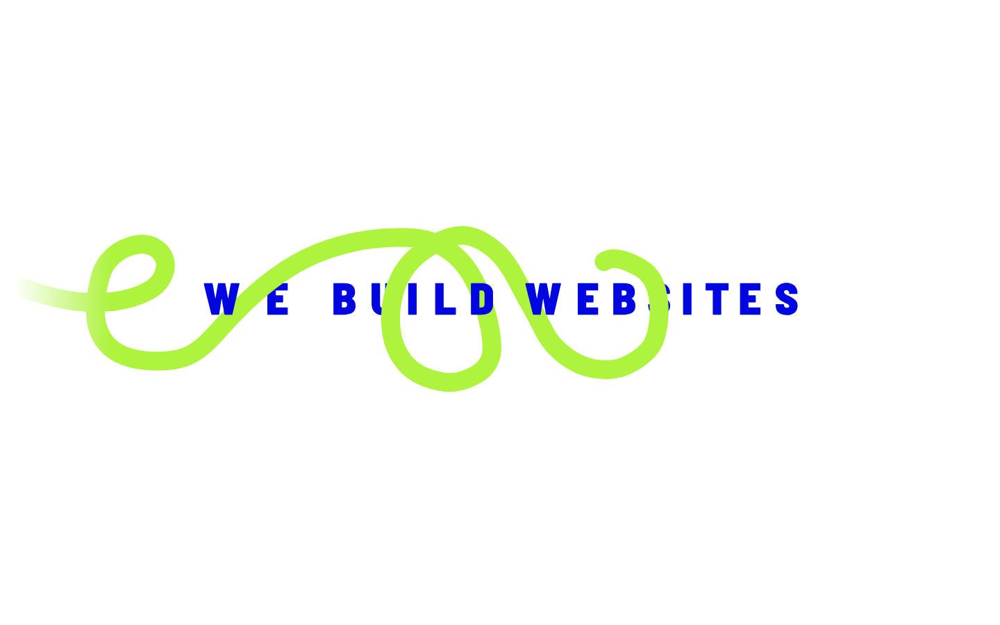
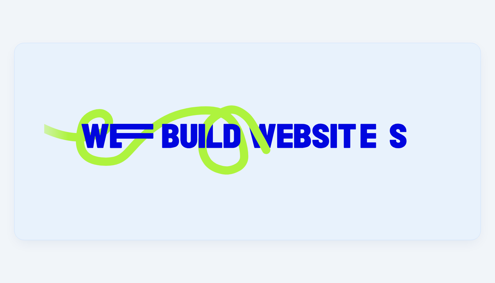

# WE BUILD WEBSITES — Kinetic Hero Section

A state-of-the-art, responsive kinetic typography and 3D looping ribbon hero section powered by [Lottie-web](https://github.com/airbnb/lottie-web) and vector SVG.



---

## ✨ Features

- **Kinetic Letter Expansion**: Dynamic horizontal beam stretch on letter `E` (3 bars) and crossbar stretch on `T` synchronized to the loop cycle.
- **3D Ribbon Weave**: Smooth continuous vector neon ribbon weaving in front of and behind individual letter contours.
- **Pure Vector & Ultra-Lightweight**: Scalable at any resolution with zero pixelation and minimal memory overhead.
- **100% Responsive**: Automatically scales across 4K displays, laptops, tablets, and smartphones.
- **Dual Themes**:
  - **Light Blue Container**: Designed for modern SaaS landing pages (`#E8F2FC`).
  - **Clean Minimal**: High-contrast white background hero design.
- **Zero Build Setup Required**: Open `index.html` directly in any web browser (`file://` or HTTP).

---

## 📸 Screenshots

| Light Blue Container | Clean Minimal |
|:---:|:---:|
|  |  |

---

## 🚀 Quick Start

### 1. Direct Browser Preview
Double-click `index.html` or open it in your browser. No server or build step required.

### 2. Local HTTP Server

```bash
# Using Python
python -m http.server 8000

# Using Node.js
npx serve .
```

Open `http://localhost:8000` in your browser.

---

## 📂 Repository Structure

```text
├── index.html                   # Primary interactive hero page with theme toggle
├── desktop.json                 # Standalone Lottie animation JSON
├── hero-standalone.html         # Minimal standalone hero component
├── hero-light-blue-preview.html # Light blue container preview
├── we_build_websites_preview.png# Preview screenshot (clean minimal)
├── light_blue_container_preview.png # Preview screenshot (light blue container)
└── README.md                    # Project documentation
```

---

## 💻 Integration Guide

To embed this hero into an existing web project:

```html
<!-- 1. Include Lottie Web CDN -->
<script src="https://cdnjs.cloudflare.com/ajax/libs/bodymovin/5.12.2/lottie.min.js"></script>

<!-- 2. Hero Container -->
<div class="hero-inner-container">
  <div class="hero-lottie-container">
    <div id="hero-lottie" class="hero-lottie-player"></div>
  </div>
</div>

<!-- 3. Initialize Animation -->
<script>
  lottie.loadAnimation({
    container: document.getElementById('hero-lottie'),
    renderer: 'svg',
    loop: true,
    autoplay: true,
    path: 'desktop.json', // or embedded JSON
    rendererSettings: {
      preserveAspectRatio: 'xMidYMid meet'
    }
  });
</script>
```

---

## 📄 License

MIT License. Free for personal and commercial use.
